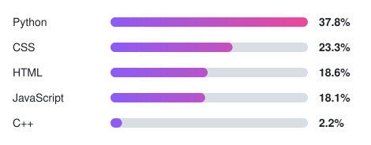

## 💻 Top Languages

<!--LANGS_START-->
<picture>
  <source media="(prefers-color-scheme: dark)" srcset="langs-dark.svg">
  <source media="(prefers-color-scheme: light)" srcset="langs-light.svg">
  
</picture>
<!--LANGS_END-->
